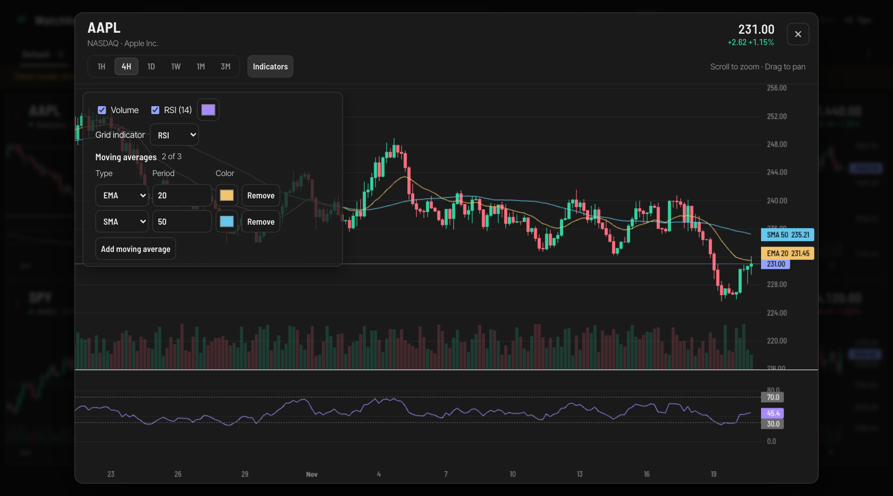

# Watchlist

Track stocks, ETFs, and crypto with candlestick charts and news in your browser.


Screenshots use simulated prices.

## Run it

Install Node.js 20.19 or newer. Clone this repository or download and extract its ZIP. [Download Node.js](https://nodejs.org/en/download)

- **macOS.** If you use Homebrew, run `brew install node`. Open Terminal in the folder that contains `package.json`.
- **Windows.** Run the Windows Installer (`.msi`) for a Node.js LTS release. Open the folder that contains `package.json` in File Explorer, type `cmd` in the address bar, and press Enter.

Run these commands in the project folder.

```sh
node -v
npm install
npm start
```

Open [http://localhost:3000](http://localhost:3000) in your browser. Keep the terminal open while you use the app. Press Ctrl+C to stop it.

For an offline demo with simulated prices, use `npm run demo` after installing dependencies.

## Organize your watchlist

- **Add symbols.** Search by ticker or company name. Press `/` to jump to search. You can also enter a full symbol such as `TWSE:0050`.
- **Group symbols.** Click **+** to add a tab. Double-click a tab to rename it or right-click it to delete it. Drag a chart by its header onto another tab to move it.
- **Arrange charts.** Drag chart headers to reorder them, or sort the current tab by ticker or daily percentage change. Click **×** on a chart to remove it.

## Explore charts

The interval buttons and candle-width slider apply to the whole grid. Hover over a chart to read candle values.

Click or tap a chart to enlarge it. Scroll or pinch to zoom, and drag to pan. The enlarged view starts with the grid’s interval and lets you change its interval and zoom independently. Press Esc to close it.

Open **Indicators** to show the settings over the chart. Turn Volume and RSI on or off, change the RSI color, or add up to three SMA or EMA lines with their own periods and colors.

Moving averages also appear on the grid chart using its candle interval. Indicator labels show only their values in both views.

If both Volume and RSI are on, use **Grid indicator** to choose which one shows on the tile. The app remembers your choices for each symbol.



## Read the news

Click **News** to see recent headlines for your watchlist. Filter by tab or symbol, then click a headline to open the story.

## Back up or move your watchlist

Your browser saves your tabs, symbols, and chart settings. Use **⋮ → Export** to download a JSON backup that includes your indicator settings.

Use **⋮ → Import…** to open a backup. Choose **Merge with my tabs** to add missing symbols or **Replace my tabs** to use the tabs and symbols from the backup. Both options apply the chart settings in the file.

## Market data

TradingView provides chart data and headlines. The app also uses Yahoo股市 for live Taiwan prices, local headlines and dividend history. Some symbols have delayed or end-of-day data. Look for the label on the chart tile. If the connection drops, the app reconnects automatically.

### TradingView login (optional)

Signing in lets the app use the market data available to your TradingView account.

1. Copy `.env.example` to `.env`.
2. Sign in to TradingView. In your browser’s developer tools, open **Application → Cookies**.
3. In `.env`, set `TV_SESSION` to the `sessionid` cookie and `TV_SIGNATURE` to `sessionid_sign`.
4. Restart the app with `npm start`.

Keep `.env` private. Anyone with those cookies can use your TradingView session.

## Settings

| Setting | Default | What it does |
| --- | --- | --- |
| `PORT` | `3000` | Sets the local server port. |
| `HOST` | `127.0.0.1` | Set it to `0.0.0.0` to reach the app from other devices on your network. |

## How it works

The Node.js server (`server.js` and `lib/`) fetches data and serves the browser app in `public/`. The charts use Lightweight Charts. [Lightweight Charts](https://www.tradingview.com/lightweight-charts/)

The app connects to TradingView through an unofficial community library. [TradingView-API](https://github.com/Mathieu2301/TradingView-API)
