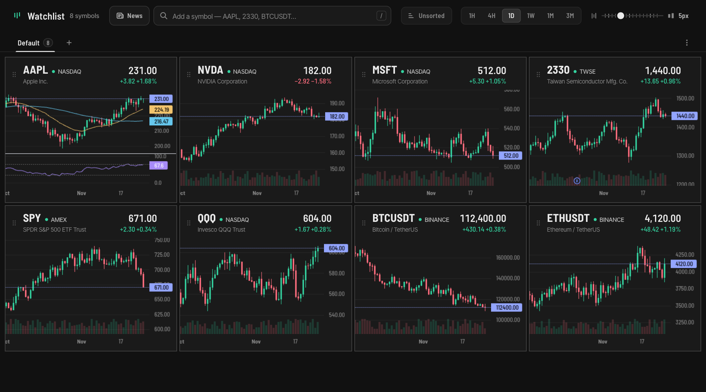

# Watchlist

Track stocks, ETFs, and crypto with candlestick charts and news in your browser.



Screenshots use simulated prices.

## Run it

Install Node.js 20.19 or newer. Clone this repository or download and extract its ZIP. [Download Node.js](https://nodejs.org/en/download)

- **macOS.** If you use Homebrew, run `brew install node`. Open Terminal in the folder that contains `package.json`.
- **Windows.** Run the Windows Installer (`.msi`) for a Node.js LTS release. Open the folder that contains `package.json` in File Explorer, type `cmd` in the address bar, and press Enter.

Run these commands in the project folder.

```sh
node -v
npm install
npm start
```

Open [http://localhost:3000](http://localhost:3000) in your browser. Keep the terminal open while you use the app. Press Ctrl+C to stop it.

For an offline demo with simulated prices, use `npm run demo` after installing dependencies.

### Start at login (macOS)

Run `bash menubar/install.sh` once. It needs Xcode's command line tools. It builds a small menu bar app that starts the server whenever you log in.

- **Menu bar icon.** Click the chart icon to open the dashboard, restart the server, or quit. Quit also stops the server.
- **Logs.** Server output goes to `~/Library/Logs/watchlist-dashboard.log`.
- **Other devices.** The server listens on all network interfaces. Devices on your Tailscale network can open `http://<tailscale-ip>:3000`. Find the IP with `tailscale ip -4`.
- **Local network.** The dashboard itself isn't locked, so anyone on your local network can open it too. [Accounts](#sync-with-an-account) only sync your board. Run `HOST=127.0.0.1 bash menubar/install.sh` to keep it to this Mac only.
- **Update or remove.** Run the install script again if you move the folder or change your Node version. Run `bash menubar/uninstall.sh` to remove it.

## Organize your watchlist

- **Add symbols.** Search by ticker or company name. Press `/` to jump to search. You can also enter a full symbol such as `TWSE:0050`.
- **Group symbols.** Click **+** to add a tab. Double-click a tab to rename it or right-click it to delete it. Drag a chart by its header onto another tab to move it.
- **Arrange charts.** Drag chart headers to reorder them, or sort the current tab by ticker or daily percentage change. Click **×** on a chart to remove it.

## Explore charts

The interval buttons and candle-width slider apply to the whole grid. Hover over a chart to read candle values.

Click or tap a chart to enlarge it. Scroll or pinch to zoom, and drag to pan. The enlarged view starts with the grid’s interval and lets you change its interval and zoom independently. Press Esc to close it.

Open **Indicators** to show the settings over the chart. Turn Volume and RSI on or off, change the RSI color, or add up to three SMA or EMA lines with their own periods and colors. Click **OK** or click outside the panel to close it.

Moving averages also appear on the grid chart using its candle interval. Indicator labels show only their values in both views.

If both Volume and RSI are on, use **Grid indicator** to choose which one shows on the tile. The app remembers your choices for each symbol.

In **Indicators**, add up to five horizontal lines per symbol. New lines start white. Set each line’s price and color or delete it there. Click or tap a line on the enlarged chart to open its settings. Drag it to set a new price. The grid shows the saved lines.

Taiwan stocks and ETFs show a **D** badge at the bottom of the chart under each ex-dividend date, on the grid and in the enlarged view. Click or tap a badge to see the ex-dividend date, amount, and payment date, with a dotted line at the ex-date. Hover a badge on the grid to see its ex-dividend date and amount; tapping it opens the enlarged chart with its details. Press Esc or click elsewhere on the chart to close it. Dividend data comes from Yahoo股市, so other markets don’t show dividends yet.


## Read the news

Click **News** to see recent headlines for your watchlist. Filter by tab or symbol, then click a headline to open the story.

## Back up or move your watchlist

Your browser saves your tabs, symbols, and chart settings. To keep them in step across browsers, [sync with an account](#sync-with-an-account). Use **⋮ → Export** to download a JSON backup that includes your indicator settings.

Use **⋮ → Import…** to open a backup. Choose **Merge with my tabs** to add missing symbols or **Replace my tabs** to use the tabs and symbols from the backup. Both options apply the chart settings in the file.

## Sync with an account

An account keeps the same board on every browser and device that uses this server. Signing in is optional; without it, the board stays in that browser.

- Open **⋮ → Sign in to sync…**, then choose **Create an account**. Use a username of 3–32 letters, numbers, dots, dashes or underscores and a password of at least 8 characters.
- Sign in on another browser. If it already has a board, you choose which one to keep.
- After that, tabs, symbols, candle interval, candle width and indicator settings sync on their own. A change shows up in your other signed-in browsers within a few seconds. If two browsers change the board at the same moment, the last change wins.
- **⋮ → Sign out** stops syncing and keeps the board on that device.

Accounts live in `data/accounts.json` on the machine that runs the server. Passwords are stored as salted hashes. The file is not in git; back it up if you care about it. Sign-in is over plain HTTP unless you put the server behind HTTPS (for example `tailscale serve`), so use it on networks you trust. Signing in doesn't lock the dashboard; anyone who can reach the server can still open it.

## Market data

TradingView provides chart data and headlines. The app also uses Yahoo股市 for live Taiwan prices, local headlines and dividend history. Some symbols have delayed or end-of-day data. Look for the label on the chart tile. If the connection drops, the app reconnects automatically.

### TradingView login (optional)

Signing in lets the app use the market data available to your TradingView account.

1. Copy `.env.example` to `.env`.
2. Sign in to TradingView. In your browser’s developer tools, open **Application → Cookies**.
3. In `.env`, set `TV_SESSION` to the `sessionid` cookie and `TV_SIGNATURE` to `sessionid_sign`.
4. Restart the app with `npm start`.

Keep `.env` private. Anyone with those cookies can use your TradingView session.

## Settings

| Setting | Default | What it does |
| --- | --- | --- |
| `PORT` | `3000` | Sets the local server port. |
| `HOST` | `127.0.0.1` | Set it to `0.0.0.0` to reach the app from other devices on your network. |
| `PD_SIGNUP` | on | Set it to `off` to stop new accounts being created from the page. |
| `PD_DATA_DIR` | `./data` | Where accounts and synced boards are stored. |

## How it works

The Node.js server (`server.js` and `lib/`) fetches data and serves the browser app in `public/`. The charts use Lightweight Charts. [Lightweight Charts](https://www.tradingview.com/lightweight-charts/)

The app connects to TradingView through an unofficial community library. [TradingView-API](https://github.com/Mathieu2301/TradingView-API)

Accounts and sync are in `lib/accounts.js` and `lib/account-routes.js` on the server, and `public/app/account.js` in the page. The macOS menu bar app is in `menubar/`.
