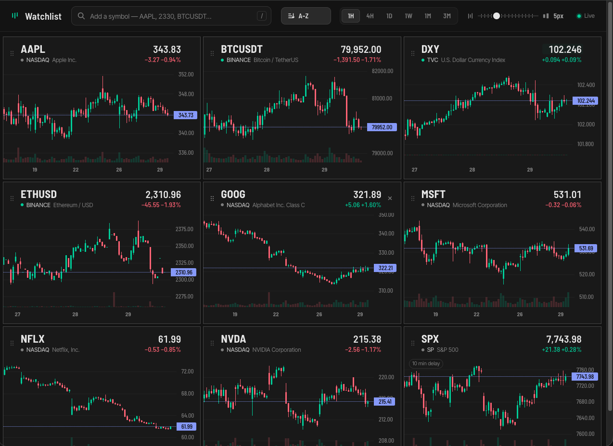

# Watchlist: a local portfolio dashboard

A dark, four-column board of live candlestick charts for the symbols you track.
Data comes from TradingView through [TradingView-API](https://github.com/Mathieu2301/TradingView-API).
Charts are drawn with [Lightweight Charts](https://www.tradingview.com/lightweight-charts/).



## Run it

You need Node.js 20.19 or newer (`node -v` to check; `brew install node` if you don't have it).

```bash
cd ~/claude/dashboard
npm install
npm start
```

Then open **http://localhost:3000**.

To try the UI without a network connection, run `npm run demo`. It uses simulated prices.

Everything the page needs, fonts included, is served from your machine. Only market data comes from TradingView.

After pulling new changes, run `npm install` again in case dependencies changed, then restart the server.

## Using the board

- **Tabs**: the tabs under the top bar group your symbols. Click a tab to open it; the grid shows only that tab's symbols.
  Click **+** after the last tab to add an empty one and type its name. Double-click a tab (or focus it and press F2) to rename it.
  Right-click a tab to rename or delete it, or focus it and press Delete. Deleting a tab removes its symbols too, so it asks first unless the tab is empty. The last remaining tab can't be deleted.
  To move a symbol to another tab, right-click its tile (or focus it and press Shift+F10) and pick the tab, or **New tab…** to start one. You can also drag a tile by its header onto a tab.
  Boards from before tabs existed open with everything in a tab called "Default".
- **Add a symbol**: press `/` or click the search bar, type a ticker or company name (`AAPL`, `2330`, `bitcoin`), then pick a result with the arrow keys and Enter.
  If you already know the full TradingView id, type it (for example `TWSE:0050`) and press Enter.
  A symbol lives in one tab only. New symbols go into the open tab; if the symbol is already in a tab, that tab opens and its tile is pointed out instead (search results say which tab has it).
- **News**: the News button left of the search bar swaps the charts for the latest headlines (last 24 hours) for every symbol on your board, across all tabs, newest first.
  With more than one tab, the buttons above the symbol chips (All, then each tab with its headline count) show only the headlines for that tab's symbols and narrow the chips to them.
  Click a symbol chip to show only its headlines (click it again to go back), and click a headline to open the full story in a new tab. The list refreshes every 5 minutes while open.
  It opens instantly: the server keeps recent headlines ready (it starts fetching them a few seconds after the page loads) and shows them at once while it checks for newer ones.
  Go back with the Charts button, Esc or your browser's back button. Headlines come from TradingView's public news feed. Taiwan-listed symbols (TWSE and TPEX) also get Traditional Chinese headlines from Yahoo股市; a story carried by both sources shows once.
  If a symbol has nothing in the last 24 hours, its latest three stories from the past two weeks appear in an "Earlier headlines" section at the end, so quiet days don't leave it blank.
- **Candle interval**: the 1H / 4H / 1D / 1W / 1M / 3M switch in the top bar sets what one candle represents on every chart, in every tab.
  For example, on 1W each candle is one week, and on 3M each candle is one quarter.
- **Candle width**: the slider next to the interval switch sets how wide candles are on every chart, in every tab, so they always match across tiles.
  It steps from 1 px to 15 px per candle (default 5 px). Slide right for wider candles (fewer on screen) and left for narrower ones (more history). Double-click the slider to reset it.
  Drag left in a chart to see older candles. Because trading hours differ, the same number of hourly or 4-hour candles covers a different stretch of calendar time for a Taiwan stock or a crypto pair than for a US stock.
- **Sort**: the sort button left of the interval switch opens a menu for ordering the open tab:
  - **Ticker A–Z / Z–A** (numbers sort naturally, so 0050 comes before 2330).
  - **Day change: gainers first / losers first**, by the day change % shown on each tile. Symbols without a price yet go last.
    This order follows prices as they move, gently: a couple of seconds after prices arrive, then at most once a minute, with tiles sliding to their new places.
    Switching to a tab sorted this way puts it in order straight away, from the latest prices its tiles have (a tab not opened since the page loaded waits for its prices first).
    It waits while your pointer is over the grid, a menu is open or you're dragging a tile, so nothing moves out from under a click.
  Each tab keeps its own setting. New symbols, and symbols moved in from another tab, go into their sorted place. Moving a tile yourself switches the button to Unsorted, and new symbols then go at the end.
- **Reorder**: drag a tile by its header. Or focus the ⋮⋮ handle (with Tab) and press ← / →.
- **Remove**: hover a tile and click ×, or right-click it and pick Remove.
- **Keyboard shortcuts** on the main screen: **← →** switch tabs (wrapping around), and **↑ ↓** scroll the open tab one row of tiles at a time, each row lining up just under the top bar.
  Arrow keys keep their usual job in the search box, the candle-width slider, the interval switch, a tile's ⋮⋮ handle (reorder) and menus. `/` jumps to the search box.
- **Inside a chart**: drag to pan and pinch to zoom that one chart. Double-click to reset it to the slider's width.
  The mouse wheel scrolls the page, not the chart.
- The dot next to the exchange shows the session: green when the market is open, amber for pre-market or after hours, grey when it's closed.
  A "15 min delay" tag means TradingView is sending delayed data for that symbol.
- **Taiwan prices are live**: free TradingView data for TWSE and TPEX is 15 minutes late, so the price and day change on Taiwan tiles come from Yahoo股市 instead, a few seconds behind the market (hover the price to see its source).
  On 1D, 1W, 1M and 3M charts the current candle follows the live price too, including the first 15 minutes of the day, before TradingView's delayed data has a candle for it.
  1H and 4H candles still come from TradingView alone, so there the newest candle can trail the price by up to 15 minutes.
  If Yahoo stops answering, the tile goes back to TradingView's delayed price and shows the delay tag.

Your tabs (names, symbols, order and sort settings), the open tab, the candle interval and the candle width are saved in your browser.
Only the open tab's symbols stream live data. Switching back to a tab within a minute is instant; after that its prices catch up within a second or two.

## Real-time data (optional)

Without a login, TradingView sends delayed data for many exchanges and keeps intraday history short.
To use your own TradingView account's data permissions:

1. Copy `.env.example` to `.env`.
2. Sign in at tradingview.com. In the browser dev tools, go to Application → Cookies and copy the `sessionid` and `sessionid_sign` values into `.env`.
3. Restart with `npm start`.

Keep `.env` private. Anyone with those cookies can use your TradingView session.

## Settings

| Variable | Default | Purpose |
| --- | --- | --- |
| `PORT` | `3000` | Port for the local server |
| `HOST` | `127.0.0.1` | Only your own machine can reach the server. Set it to `0.0.0.0` to open the board from other devices on your network. |
| `TV_SESSION`, `TV_SIGNATURE` | (empty) | TradingView cookies for real-time data |

## How it's built

```
server.js            Express + WebSocket server. Shares one upstream stream per symbol/interval across tabs, keeps it
                     warm for 60 s after the last tab leaves, and reconnects on its own. Serves fonts and the chart library
lib/tv-source.js     TradingView-API v4: searchMarkets, watchCandles, and one shared quote session, all on one connection
lib/news.js          Headlines per symbol: 24-hour window (older fallback for quiet symbols), duplicates merged, 5-minute cache (older results shown at once while newer ones load)
lib/yahoo-tw-news.js Yahoo股市 (zh-TW) headlines for Taiwan listings (TWSE:2330 -> 2330.TW, TPEX:6488 -> 6488.TWO), read from each stock's news page
lib/yahoo-tw-quotes.js Live Yahoo股市 prices for Taiwan listings: one shared poll every 5 s for all of them (every 60 s after the close)
lib/demo-source.js   Simulated data and sample headlines for `npm run demo`
public/index.html    Page layout
public/styles.css    Dark theme
public/app.js        Search, grid, charts, drag-to-reorder, live updates. Charts are only built for tiles near the screen
public/timeframes.js Candle intervals, used by both the server and the browser
```

TradingView-API is an unofficial community library and is not affiliated with TradingView.
It's fine for personal use; check TradingView's terms before doing anything more with it.
